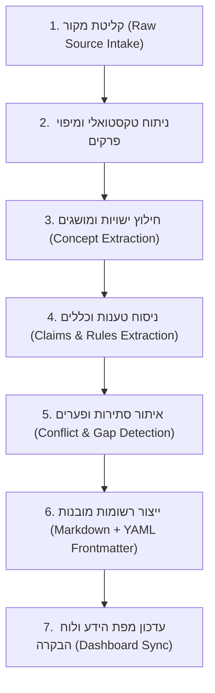

# ארכיטקטורת קליטת ספרות קולינרית מקצועית (Book Ingestion Architecture)

> [!NOTE] מטרת המסמך
> מסמך זה מגדיר את הצינור המתודולוגי (Ingestion Pipeline) לחילוץ עקרונות, עובדות מדעיות, כללי החלטה ומדדי טמפרטורה מתוך ספרי יסוד קולינריים ומדעיים, תוך שמירה מלאה על עקיבות מקורות (Provenance) וללא הזיות או ניחושים.

---

## 1. עקרונות ברזל בקליטת ידע (Immutable Ingestion Principles)

1. **שרשרת עקיבות חסינה (Absolute Traceability):**
   כל טענה, כלל או סף טמפרטורה חייבים להיות מוצמדים למזהה מקור מוסמך (`SRC-xxx`), כולל ציון פרק, עמוד ומספר פסקה מדויק.
2. **אפס המצאת ציטוטים (Zero Hallucinated Citations):**
   אם טענה אינה מופיעה מפורשות בעמוד המצוטט, היא מוגדרת כ-`INFERENCE` או נפסלת.
3. **הפרדת עובדות מהמלצות (Separation of Fact from Practical Rule):**
   - **עובדה מדעית (Fact):** "חלבון אלבומין נקרש ב-62°C-65°C".
   - **כלל בישול (Rule):** "להכנת קוסטרד יציב ורך יש לבשל באמבט מים (Bain-Marie) בחום שלא יעלה על 80°C".
4. **שימור אי-ודאות וסתירות:**
   אם שני מחברים חלוקים (למשל האם המלחה מוקדמת מייבשת סטייק או משפרת שמירת נוזלים), שתי הגישות נשמרות ומתועדות בתבנית `[[11_Conflicts/|קונפליקטים]]`.

---

## 2. שלבי צינור הקליטה (The 7-Stage Pipeline)



### שלב 1: רישום המקור (Source Registration)
יצירת קובץ מקור תחת `09_Sources/` לפי `[[Knowledge-Source-Template]]`.
- הגדרת מזהה מקור יציב: `SRC-MCGEE-2004`, `SRC-MODCUIS-2011`, `SRC-FOODLAB-2015`.
- הגדרת סיווג אמינות (`credibility_tier`):
  - `TIER_1_ACADEMIC`: מאמרי ביקורת עמיתים, דוחות מעבדה מבוקרים, פרסומי USDA/FDA.
  - `TIER_2_AUTHORITATIVE_CULINARY`: ספרי מדע בישול נחשבים (McGee, Myhrvold, López-Alt).
  - `TIER_3_EMPIRICAL_TESTED`: מתכונים וניסויים מתועדים של מפתחי מתכונים מקצועיים.

### שלב 2: סריקה נושאית ומיפוי ל-8 תחומי האונטולוגיה
סיווג כל קטע תוכן לאחד או יותר מ-8 התחומים הראשיים:
1. `01_Ingredients`
2. `02_Food-Science`
3. `03_Techniques`
4. `04_Flavors`
5. `05_Textures`
6. `06_Equipment`
7. `07_Food-Safety`
8. `08_Decision-Making`

### שלב 3: חילוץ ישויות ועקרונות (Entity & Principle Extraction)
חילוץ ערכים מוגדרים:
- **ספי טמפרטורה:** ערך מדויק, יחידות (°C), טווח ביטחון.
- **מגיבים כימיים:** סוכרים, חלבונים, חומצות, שומנים.
- **פרמטרי שליטה:** זמן, עובי, יחס משקלי, לחות יחסית ($RH$).

### שלב 4: ניסוח כללי החלטה (Culinary Rules)
כל המלצה מעשית מומרת לתחביר תנאי-תוצאה מובנה:
```yaml
condition:
  ingredient: beef_steak
  thickness_mm: ">= 35"
  desired_doneness: medium_rare (54°C)
technique: reverse_sear
actions:
  step_1: "ייבוש פני שטח במקרר 12-24 שעות"
  step_2: "אפייה איטית ב-105°C עד לטמפ' ליבה של 48°C"
  step_3: "מנוחה קצרה"
  step_4: "צריבה לוהטת של 45 שניות לכל צד ב-230°C במחבת ברזל יצוק"
scientific_rationale: "[[Heat-Transfer]], [[Maillard-Reaction]], [[Surface-Browning]]"
```

### שלב 5: בקרת קונפליקטים וסתירות (Conflict Resolution)
בדיקה האם הכלל או הטענה סותרים ידע קיים:
- אם נמצאה סתירה: יצירת רשומה חדשה ב-`11_Conflicts/` לפי `[[Contradictory-Claim-Template]]`.
- אין להכריע סתירה באופן שרירותי; יש לתעד את תנאי היישום של כל צד.

### שלב 6: שמירת רשומות Obsidian בפורמט התבניות
כתיבת הקבצים לנתיב היעד המתאים ב-`Culinary-Knowledge/` עם שמות קבצים באנגלית (למשל `Sous-Vide-Egg-Pasteurization.md`) וגוף עשיר בעברית עם קישורים פנימיים (`[[...]]`).

### שלב 7: אינדוקס ממוחשב
סריקה של כל קבצי ה-YAML ועדכון מוני הכיסוי ב-`[[Dashboard]]`.

