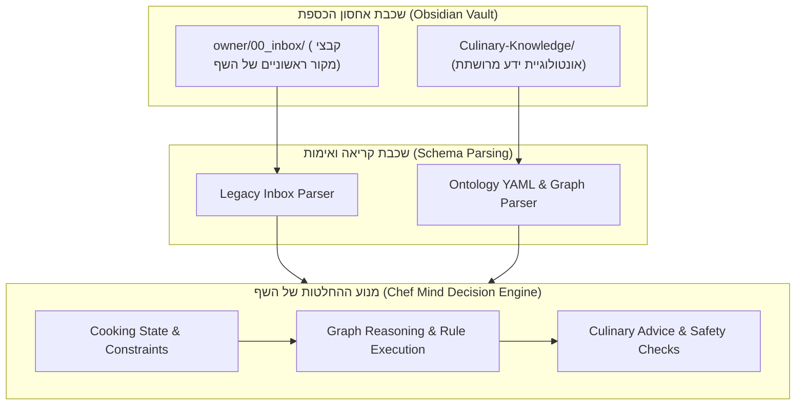

# שילוב מנוע השף ומערכת הידע הקולינרי (Chef Engine Integration Specification)

> [!NOTE] עקרון אי-הפרעה הדדית (Zero-Disruption Principle)
> מבנה הנתונים ב-`Culinary-Knowledge/` תוכנן כך שהוא **אינו משנה ואינו פוגע** בקבצים הקיימים ב-`owner/00_inbox/` או בקוד מנוע ה-Python של `chef_mind`. המערכת מהווה הרחבה אונטולוגית רחבה המאפשרת ייצוא ישיר למודלי הנתונים של מנוע השף.

---

## 1. ארכיטקטורת שכבות הידע (Layered Knowledge Architecture)



---

## 2. מיפוי סכמת YAML למודלי Pydantic של מנוע השף

מנוע השף (`chef_mind`) צורך רשומות ידע ומבצע עליהן הסקה. להלן טבלת המיפוי המדויקת בין שדות ה-YAML Frontmatter באונטולוגיה לבין יחידות הידע של השף:

| שדה באונטולוגיית הידע (`Culinary-Knowledge`) | שדה מקביל במודל הידע של `chef_mind` | תיאור תפקיד ועיבוד |
| :--- | :--- | :--- |
| `id` (למשל `RUL-HEAT-001`, `SCI-CHEM-001`) | `knowledge_id` | מזהה יציב וייחודי ברחבי המערכת |
| `name` / `title_he` | `title` | כותרת הרשומה להצגה למשתמש |
| `domain` / `subdomain` | `tags` (מורחב) | שיוך היררכי לתחום הידע (מדע, טכניקה, חומר גלם) |
| `scientific_principle` / `mechanism` | `principle` | העיקרון המדעי המנחה את הפעולה |
| `conditions` (אובייקט תנאי סף) | `conditions` (רשימת תנאים) | תנאי סף לקיום הפעולה (טמפרטורה, עובי, חומר גלם) |
| `effects` / `actions` | `recommended_action` | הפעולה הקולינרית המומלצת למשתמש או לשף |
| `safety_hazards` / `food_safety` | `safety_notes` | התראות בטיחות קריטיות (חיידקים, כוויות, רעלנים) |
| `sources` / `citation` | `source_id` / `attribution` | שרשרת ההוכחה (Provenance) והמקור המצוטט |
| `confidence_score` (0-100) | `confidence` | רמת הביטחון המדעית בתוצאה |
| `verification_status` | `verified_on` / סטטוס תיקוף | האם המידע אושר אקדמית או שהוא בגדר דוגמה ראשונית |

---

## 3. מינוף קשרי הגרף (`relationships`) במנוע הסו-שף

בניגוד למסמכים שטוחים, רשומות האונטולוגיה מכילות מערך קשרים סמנטי (`relationships`):
- `REQUIRES`: תנאי מקדים חובה (למשל: ייבוש שטח הפנים לפני צריבה).
- `ENABLES`: פתיחת אפשרויות קולינריות (למשל: הגעה ל-140°C מאפשרת השחמה).
- `INHIBITED_BY`: מניעת כשלים (למשל: נוכחות מים מעכבת השחמה).
- `ALTERNATIVE_TO`: הצעת חלופות טכנולוגיות כשיש מגבלת ציוד.

מנוע השף יכול לבצע שאילתות גרף פשוטות בפורמט:
```python
# שאילתת הסקה: מדוע הטכניקה נכשלה?
if not conditions_met(rule.requires):
    diagnose_failure(missing_prerequisites)
```

---

## 4. מנגנון ייצוא נתונים אוטומטי (JSON / Vector Store Ready)
כל קובץ Markdown ב-`Culinary-Knowledge/` ניתן לקריאה ישירה באמצעות מנתח YAML סטנדרטי (כגון `yaml.safe_load` או `frontmatter`), המאפשר:
1. שמירה שקופה של קבצי `.md` לעריכה נוחה באובסידיאן.
2. המרה ממוכנת ל-JSON לטעינה בזמן עליית שרת ה-API של `chef_mind`.
3. הטמעה מבוססת וקטורים (Vector Embeddings) של הטקסט העברי העשיר לצורך חיפוש סמנטי.

