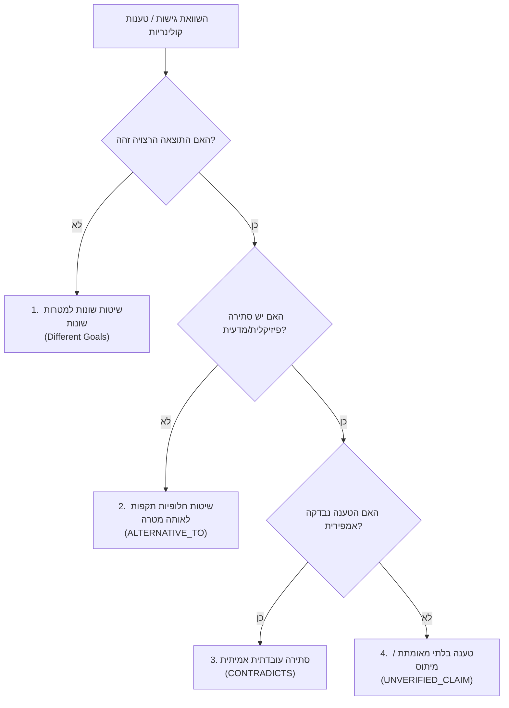

# מודל קשרי הידע הקולינרי (Culinary Knowledge Relationship Model)

בקבצי הספרים נוסף קשר ניווט `MENTIONS`: דף מקור מזכיר מושג קיים.
זהו מיפוי לשוני בלבד, ולא קשר סיבתי, אישור מדעי או אישור לביצוע.
`PART_OF` מחבר דף מקור למפת הפרק שלו; `SUPPORTED_BY` משמר את מקור ההערה.

מסמך זה מגדיר את סוגי הקשרים הסמנטיים (Graph Edges) המקשרים בין ישויות הידע במערכת. המודל מיועד לקריאה אנושית ב-Obsidian ולקריאה חישובית (Machine-Readable) על ידי מנוע קבלת ההחלטות של השף.

---

## 1. סוגי קשרים נתמכים (Supported Relationship Types)

| קשר (Relationship) | משמעות סמנטית | כיוון הקשר | דוגמה קולינרית |
| :--- | :--- | :--- | :--- |
| **`IS_A`** | ירושה / סיווג טקסונומי | ספציפי $\rightarrow$ כללי | `Ribeye IS_A Beef_Cut` |
| **`PART_OF`** | שייכות מבנית / רכיב במערכת | חלק $\rightarrow$ שלם | `Myosin PART_OF Muscle_Protein` |
| **`HAS_PROPERTY`** | תכונה פיזיקלית/כימית מהותית | ישות $\rightarrow$ תכונה | `Cast_Iron HAS_PROPERTY High_Thermal_Mass` |
| **`AFFECTS`** | השפעה ישירה על משתנה או תהליך | גורם $\rightarrow$ מושפע | `Temperature AFFECTS Reaction_Rate` |
| **`REQUIRES`** | תנאי קדם הכרחי לקיום התהליך | תהליך $\rightarrow$ תנאי קדם | `Maillard_Reaction REQUIRES Low_Surface_Moisture` |
| **`ENABLES`** | פותח אפשרות או מאיץ תהליך | גורם $\rightarrow$ תוצאה | `High_Heat ENABLES Rapid_Crust_Formation` |
| **`INHIBITS`** | מעכב, מונע או מאט תהליך | גורם $\rightarrow$ תהליך מועכב | `Excess_Moisture INHIBITS Maillard_Reaction` |
| **`ALTERNATIVE_TO`** | גישה חלופית תקפה לאותה מטרה | פתרון א' $\leftrightarrow$ פתרון ב' | `Sous_Vide ALTERNATIVE_TO Low_Slow_Roasting` |
| **`SUPPORTED_BY`** | ביסוס מדעי / מקור מקצועי מאומת | טענה $\rightarrow$ מקור ראיה | `Rule_01 SUPPORTED_BY McGee_On_Food_And_Cooking` |
| **`CONTRADICTS`** | סתירה עובדתית בין שתי טענות | טענה א' $\leftrightarrow$ טענה ב' | `Claim_Sear_Locks_Juices CONTRADICTS Moisture_Loss_Data` |

---

## 2. עקרון ריבוי הפתרונות התקפים (Plurality of Valid Approaches)

שאלה קולינרית עשויה לכלול מספר פתרונות לגיטימיים. **לעולם אין לאחד בכפייה מספר גישות לגיטימיות לתשובה אחת פשטנית.**

המערכת מבחינה באופן שיטתי בין 4 מצבים:



### פירוט המצבים:
1. **שיטות שונות להשגת מטרות שונות (`Different Goals`)**:
   * *דוגמה*: טיגון בצל בחום גבוה (להשגת קצוות שחומים פריכים) מול אידוי איטי בחום נמוך (להשגת ריכוך עמוק ושקיפות ללא השחמה). אין כאן סתירה; שתיהן נכונות בהתאם למנת היעד.
2. **שיטות תקפות שונות להשגת אותה מטרה (`ALTERNATIVE_TO`)**:
   * *דוגמה*: ריכוך נתח שריר עשיר בקולגן ניתן לבצע באמצעות סו-וויד ב-68°C למשך 24 שעות או בסיר לחץ ב-120°C למשך 45 דקות.
3. **סתירה עובדתית אמיתית (`CONTRADICTS`)**:
   * *דוגמה*: הטענה המסורתית ש"צריבת בשר נועלת את המיצים בפנים" **סותרת** ישירות את המדידות האמפיריות של איבוד משקל ונוזלים בחום גבוה (צריבה יוצרת טעם וקראסט, אך מגבירה איבוד נוזלים מקומי).
4. **טענות בלתי מאומתות (`UNVERIFIED_CLAIM`)**:
   * טיפים עממיים ופולקלור מטבח שאינם נתמכים בראיות ביולוגיות או תרמודינמיות מקוטלגים כ-`UNVERIFIED` עד לבדיקה.

---

## 3. ייצוג קשרים במבנה נתונים (Machine-Readable Schema)

כל קשר מיוצג בתוך ה-YAML frontmatter של הקובץ במבנה אחיד:

```yaml
relationships:
  - type: REQUIRES
    target_id: SCI-WATER-001
    target_name: Low_Surface_Moisture
    context: "Surface temperature cannot exceed 100°C until free surface water has evaporated."
  - type: ENABLES
    target_id: TEX-CRUST-001
    target_name: Surface_Crust_Formation
    context: "Dehydration combined with Maillard polymerisation creates crisp texture."
  - type: INHIBITED_BY
    target_id: COND-WET-002
    target_name: Liquid_Crowding
    context: "Crowding pan traps steam, dropping pan temperature."
```

---

## 4. מוסכמות שמות ומזהים יציבים (Stable Identifiers)

מזהים יציבים (Stable IDs) אינם תלויים בשם הקובץ ומאפשרים שינויי שמות ומיקומים ללא שבירת הקשרים:

* `ING-xxx`: חומר גלם (Ingredient)
* `SCI-xxx`: עיקרון מדעי (Scientific Principle)
* `TEC-xxx`: טכניקת בישול (Cooking Technique)
* `FLV-xxx`: טעם וארומה (Flavor & Aroma)
* `TEX-xxx`: מרקם (Texture)
* `EQP-xxx`: ציוד (Equipment)
* `SAF-xxx`: בטיחות מזון (Food Safety)
* `RUL-xxx`: כלל קולינרי (Culinary Rule)
* `GAP-xxx`: פער ידע (Knowledge Gap)
* `CON-xxx`: קונפליקט / סתירה (Conflict)
* `SRC-xxx`: מקור ידע (Knowledge Source)

