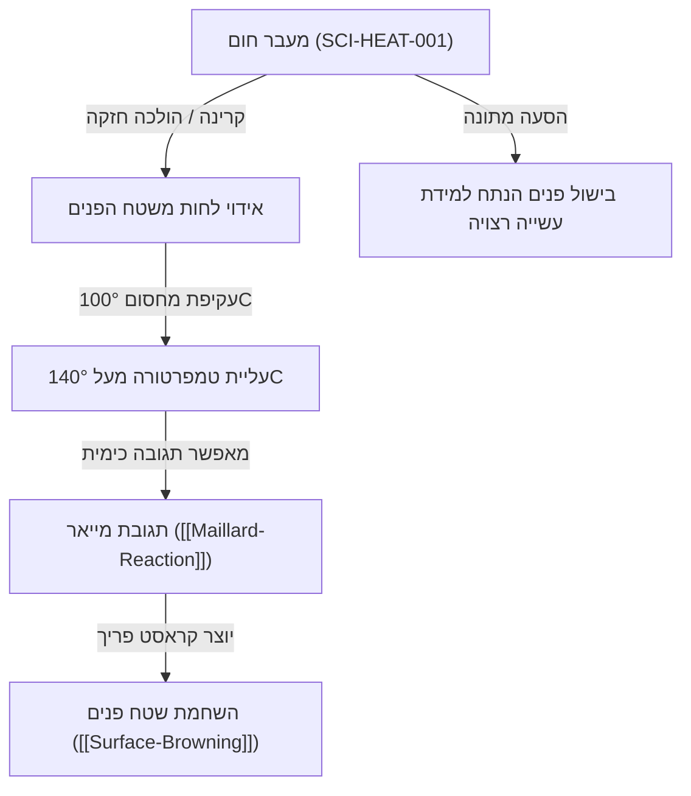

# מעבר חום בבישול (Heat Transfer)

> [!NOTE] סטטוס רשומה: דוגמת תשתית ראשונית (Preliminary Example)
> רשומה זו משמשת כהדגמה תשתיתית לחיבור בין עקרונות מדעיים, טכניקות בישול וטרנספורמציות מרקם. הנתונים מתארים עקרונות פיזיקליים אוניברסליים.

---

## 1. הגדרה מדעית (Scientific Definition)
מעבר חום הוא תנועת אנרגיה תרמית מאזור בטמפרטורה גבוהה לאזור בטמפרטורה נמוכה יותר, במטרה להגיע לשיווי משקל תרמי. במערכות קולינריות, מעבר החום מתבצע בשלושה מנגנונים מקבילים או משולבים:

1. **הולכה (Conduction):** מעבר אנרגיה קינטית ברמה המולקולרית דרך מגע ישיר (למשל: מחבת ברזל לוהטת במגע ישיר עם שטח פני סטייק).
2. **הסעה (Convection):** מעבר חום באמצעות תנועת זורם (נוזל או גז) – טבעית (ציפה עקב שינויי צפיפות) או מאולצת (מאוורר טורבו בתנור או משאבת סו-וויד).
3. **קרינה (Radiation):** מעבר חום באמצעות קרינה אלקטרומגנטית (בעיקר אינפרא-אדום) ללא צורך בתווך חומרי (למשל: גריל עליון/סלמנדרה, גחלים לוחשות).

---

## 2. חוק פורייה והתנהגות תרמית במזון
הולכת החום בתוך מזון מוצק נשלטת על ידי חוק פורייה:
$$q = -k \nabla T$$

כאשר:
- $q$ הוא שטף החום ($W/m^2$).
- $k$ הוא מוליכות החום של המזון ($W/m\cdot K$). מים מוליכים חום פי 3-4 טוב יותר משומן, בעוד אוויר כלוא הוא מבודד מעולה.
- $\nabla T$ הוא גרדיאנט הטמפרטורה בין שטח הפנים למרכז המזון.

### דיפוסיביות תרמית (Thermal Diffusivity - $\alpha$)
$$\alpha = \frac{k}{\rho \cdot c_p}$$
המדד לקצב שבו חום חודר לתוך נתח מזון. מזונות עתירי מים הם בעלי קיבול חום סגולי גבוה ($c_p$), ולכן דורשים זמן רב יותר להעלאת הטמפרטורה הפנימית.

---

## 3. קשרים והשפעה הדדית ברשת הידע

---

## 4. תנאי סף ומגבלות קריטיות (Critical Thresholds)
- **מחסום אידוי המים (Evaporative Barrier):** כל עוד ישנם מים חופשיים בשטח פני המזון, טמפרטורת פני השטח לא תעלה מעל כ-100°C (טמפרטורת רתיחת המים בלחץ אטמוספרי), עקב החום הכמוס של האידוי ($2260\,kJ/kg$).
- **השלכה קולינרית:** לא ניתן לייצר השחמה או פריכות אמיתית ([[Surface-Browning]]) מבלי לייבש לחלוטין את שטח הפנים של חומר הגלם.

---

## 5. קישורים לרשומות קשורות
- תגובות כימיות נתמכות: `[[Maillard-Reaction]]`
- טרנספורמציות מרקם מושפעות: `[[Surface-Browning]]`
- כלים קשורים: `[[06_Equipment/Equipment-Overview]]`
- טכניקות מבוססות: `[[03_Techniques/Techniques-Overview]]`

