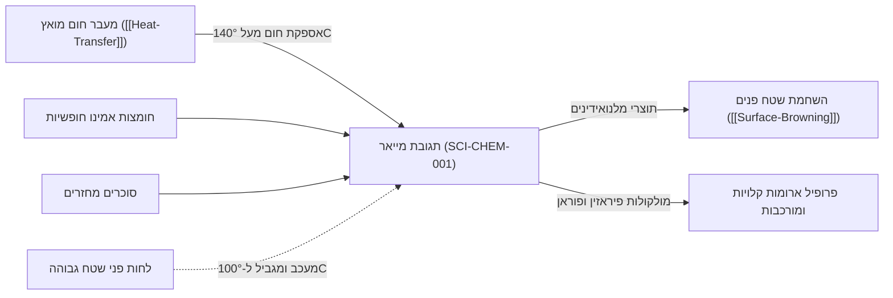

# תגובת מייאר (Maillard Reaction)

> [!NOTE] סטטוס רשומה: דוגמת תשתית ראשונית (Preliminary Example)
> רשומה זו מדגימה תגובה ביוכימית מורכבת המחברת בין מדע מעבר חום (`[[Heat-Transfer]]`), פיתוח ארומות וטעמים (`[[04_Flavors/Flavors-Overview]]`), והיווצרות קראסט ומרקם פריך (`[[Surface-Browning]]`).

---

## 1. הגדרה מדעית ומנגנון כימי (Mechanism Overview)
תגובת מייאר (התגלתה על ידי הכימאי הצרפתי לואי קאמי מייאר ב-1912) היא רשת מורכבת של אלפי תגובות כימיות לא-אנזימטיות, המתרחשות בין קבוצת אמינו חופשית (של חומצת אמינו או חלבון) לבין קבוצת קרבוניל של סוכר מחזר.

### שלבי התגובה העיקריים:
1. **שלב ראשוני (Early Stage):** עיבוי של הסוכר המחזר והאמין ליצירת גליקוזילאמין בלתי-יציב, העובר סידור מחדש של אמאדורי (Amadori Rearrangement) או היינס (Heyns). שלב זה חסר צבע וריח.
2. **שלב ביניים (Intermediate Stage):** דה-הידרציה, פירוק סוכרים ודגרדציה של סטרקר (Strecker Degradation), המייצרת תרכובות קרבוניליות נדיפות ואלדהידים נדיפים בעלי פרופילי ארומה עוצמתיים.
3. **שלב סופי (Final Stage):** פילמור ודחיסה של תרכובות הניטרוגן ליצירת **מלנואידינים (Melanoidins)** – פולימרים חומים בעלי משקל מולקולרי גבוה, האחראים לצבע השחום ולמרקם הקשה/פריך של קרום המזון.

---

## 2. תנאי סף סביבתיים ופרמטרי בקרה (Control Parameters)

| פרמטר סביבתי | ערך אופטימלי | השפעה על התגובה |
| :--- | :--- | :--- |
| **טמפרטורת פני שטח** | 140°C עד 165°C | מתחת ל-130°C התגובה איטית ביותר; מעל 180°C מתחילה פירוליזה (שריפה ויצירת טעמי מרירות וקרצינוגנים). |
| **לחות ופעילות מים ($a_w$)** | 0.55 עד 0.80 | מים רבים מדי שומרים על טמפ' של 100°C ומונעים את התגובה; יובש קיצוני מאט את מוביליות המגיבים. |
| **רמת חומציות (pH)** | בסיסי קל (pH > 7.0) | חומציות מנטרלת את קבוצת האמינו ומעכבת את התגובה. סודה לשתייה (אלקליות) מאיצה דרמטית את ההשחמה. |

---

## 3. קשרים באונטולוגיה (Knowledge Graph Integration)

---

## 4. הבחנה מדעית קריטית: מייאר מול קרמליזציה
- **קרמליזציה (Caramelization):** פירוליזה תרמית של סוכרים טהורים בלבד (דורשת טמפ' גבוהה יותר, לרוב מעל 160°C-180°C בהתאם לסוכר) **ללא מעורבות חלבונים או חומצות אמינו**.
- **תגובת מייאר:** מחייבת נוכחות משולבת של **חלבון + סוכר מחזר** ויכולה לפעול ביעילות כבר ב-140°C.

---

## 5. קישורים והפניות הדדיות
- עקרונות תרמודינמיים מקדימים: `[[Heat-Transfer]]`
- תוצאה מרקמית מופעלת: `[[Surface-Browning]]`
- עקרונות ארומה וטעם: `[[04_Flavors/Flavors-Overview]]`
- תבנית מקורות מאמתים: `[[Knowledge-Source-Template]]`

