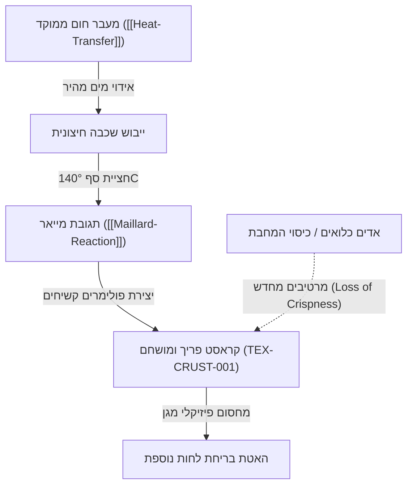

# השחמת שטח פנים ויצירת קראסט (Surface Browning & Crust Formation)

> [!NOTE] סטטוס רשומה: דוגמת תשתית ראשונית (Preliminary Example)
> רשומה זו מדגימה כיצד מדע תרמודינמי (`[[Heat-Transfer]]`) ותגובות כימיות מולקולריות (`[[Maillard-Reaction]]`) מתבטאות בסופו של דבר במרקם מוחשי, קראנצ'י ופריך בחוויית האכילה.

---

## 1. הגדרה מרקמית ופיזיקלית (Physical Transformation)
קראסט (Crust) הוא שכבה חיצונית דקה, מיובשת ונוקשה הנוצרת על פני המזון במהלך צלייה, אפייה, טיגון עמוק או טיגון במחבת. 

היווצרות הקראסט הפריך מתרחשת כאשר **קצב אידוי המים משטח הפנים עולה באופן משמעותי על קצב פעפוע המים (Water Diffusion) ממרכז המזון אל פני השטח**. כתוצאה מכך:
1. שטח הפנים מתייבש ומגיע לערכי פעילות מים נמוכים ($a_w < 0.3$).
2. הטמפרטורה חוצה את סף 140°C ומפעילה את תגובת מייאר (`[[Maillard-Reaction]]`) וקרמליזציה.
3. פוליסכרידים וחלבונים עוברים דחיסה וצילוב, ונכנסים ל**מצב זכוכיתי (Glassy State)** בטמפרטורת החדר.

---

## 2. התנאי הפיזיקלי לפריכות: מרוץ הזמנים התרמי
כדי שייווצר קראסט פריך ולא שכבה רכה ומבושלת (Soggy), נדרש איזון מדויק הנשלט על ידי `[[Heat-Transfer]]`:

$$J_{evaporation} > J_{diffusion}$$

- אם שטף החום נמוך מדי, מים ימשיכו לפעפע מהפנים החוצה, טמפרטורת פני השטח תישאר סביב 100°C, והשכבה החיצונית תתבשל באידוי עצמי במקום להיחרך ולהתייבש.
- אם שטח הפנים יובש מראש (למשל: ייבוש נתח במקרר ללא כיסוי למשך 24 שעות או ייבוש במגבות נייר), מחסום המים נפרץ מידית, והקראסט נוצר בשניות בודדות ללא בישול-יתר (Overcooking) של הליבה.

---

## 3. קשרים הדדיים ברשת הידע

---

## 4. גורמים המשמידים פריכות (Loss of Texture)
- **עיבוי קיטור (Steam Trapping):** סגירת מכסה לאחר טיגון או הנחת מזון פריך ישירות על משטח אטום כולאת את אדי המים המשתחררים מהליבה החמה. האדים נספגים מחדש בקראסט הזכוכיתי ומחזירים אותו למצב גמיש (Rubbery/Soggy).
- **מנוחה על רשת (Resting on Wire Rack):** כדי לשמר קראסט מושלם, יש להניח את המזון על רשת מאווררת המאפשרת לאדים להתפזר ללא עיבוי תחתיתי.

---

## 5. קישורים לרשומות קשורות באונטולוגיה
- עקרונות כימיים מחוללים: `[[Maillard-Reaction]]`
- עקרונות תרמודינמיים נדרשים: `[[Heat-Transfer]]`
- סיווג מרקמים ראשי: `[[05_Textures/Textures-Overview]]`
- תבנית מקורות מאמתים: `[[Knowledge-Source-Template]]`

