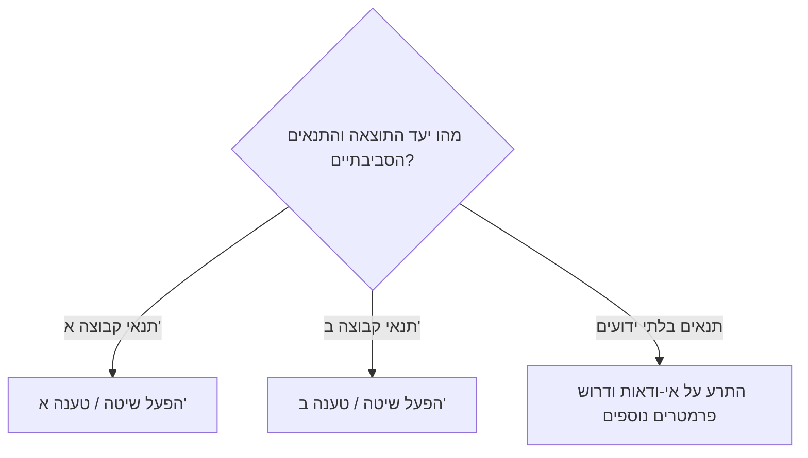

# [שם הקונפליקט / הסתירה הקולינרית]

> [!CAUTION] עקרון הטיפול בסתירות
> לעולם אין ליישר סתירות באופן מלאכותי או להכריח מסקנה אחת ללא ביסוס. במדע הבישול, סתירות רבות נובעות מתנאי שפה שונים (קונטקסט), לחות שונה, עובי נתח או יעדי תוצאה שונים.

---

## 1. תיאור הסתירה (Conflict Overview)
תיאור תמציתי של המחלוקת: מדוע שני מקורות סמכותיים או שפים בעלי שם מציגים מסקנות הפוכות לגבי אותה פעולה?

---

## 2. פירוט הטענות המתחרות (Competing Claims)

### טענה א' (Claim A)
- **הטענה:** [פירוט מלא של הטענה]
- **המקור המצוטט:** `[[Knowledge-Source-Template]]`
- **התנאים שבהם נבדקה הטענה:** (טמפרטורה, כלי בישול, זן חומר הגלם וכו')
- **התוצאה המובטחת:**

### טענה ב' (Claim B)
- **הטענה:** [פירוט מלא של הטענה]
- **המקור המצוטט:** `[[Knowledge-Source-Template]]`
- **התנאים שבהם נבדקה הטענה:** (טמפרטורה, כלי בישול, זן חומר הגלם וכו')
- **התוצאה המובטחת:**

---

## 3. ניתוח גורמי ההבדל (Root Cause Analysis)
ניתוח מעמיק של ההבדלים המדעיים והטכניים:
1. **הבדלי תנאים (Environmental & Physical Conditions):**
   - האם היה הבדל בריכוז המלח / בלחות היחסית / בסוג החום (הסעה מול הולכה)?
2. **הבדלי יעדים (Target Objectives):**
   - האם שיטה אחת מכוונת לפריכות מקסימלית בעוד השנייה מכוונת לשמירת עסיסיות פנימית?
3. **הבדלי הגדרות (Semantics):**
   - האם המונח מוגדר באופן שונה בין המקורות (למשל: מה נחשב "חריכה" מול "השחמה")?

---

## 4. מודל הפיוס וההכרעה המדעית (Reconciliation Model)
כיצד מנוע ההחלטות צריך להתייחס לקונפליקט זה?

---

## 5. השפעה על כללי ההחלטה (Rule Updates)
- כללים שהושפעו או עודכנו עקב הסתירה: `[[Culinary-Rule-Template]]`
- רשומות מחקר נוספות: `[[Knowledge-Gap-Template]]`

