# לוח בקרה ראשי: אונטולוגיית הידע הקולינרי (Culinary Knowledge Dashboard)

## מדריכים לבישול בשפה פשוטה

- [[SRC-FDA-SEAFOOD-CONSUMER|מדריך FDA לקנייה, הכנה ואחסון דגים — תקציר ועותק מקומי]]
- [[SRC-FRDC-FISH-POACHING|כמה זמן לבשל דג? הערכה לפי עובי]]
- [[Culinary-Plain-Language-Glossary|מילון בישול: הסברים למונחים מקצועיים]]

> [!NOTE] סביבת עבודה מקומית באובסידיאן (Obsidian Native)
> לוח בקרה זה נבנה בתחביר Markdown תקני הנתמך במלואו על ידי מנוע Obsidian ומסונכרן אוטומטית מול מנוע ההחלטות של `chef_mind` (`app/ontology_bridge.py`).

---

## א. ניווט מהיר ברשת הידע (Knowledge Navigation)

```mermaid
graph LR
    subgraph Core ["תשתית האונטולוגיה"]
        Map["[[Knowledge-Map|מפת הידע הראשית]]"]
        Rel["[[Relationships|מודל הקשרים]]"]
        Con["[[Concepts|טקסונומיית מושגים]]"]
    end

    subgraph Domains ["8 תחומי הידע המרכזיים"]
        D1["[[01_Ingredients/|01. חומרי גלם]]"]
        D2["[[02_Food-Science/|02. מדע המזון]]"]
        D3["[[03_Techniques/|03. טכניקות בישול]]"]
        D4["[[04_Flavors/|04. טעמים וארומות]]"]
        D5["[[05_Textures/|05. מרקמים]]"]
        D6["[[06_Equipment/|06. ציוד וסביבה]]"]
        D7["[[07_Food-Safety/|07. בטיחות ושימור]]"]
        D8["[[08_Decision-Making/|08. קבלת החלטות]]"]
    end

    subgraph Operations ["ניהול, אימות ואיכות"]
        Sources["[[09_Sources/|09. מקורות]]"]
        Gaps["[[10_Knowledge-Gaps/|10. פערי ידע]]"]
        Conflicts["[[11_Conflicts/|11. סתירות ומחלוקות]]"]
        Rules["[[12_Rules/|12. כללי החלטה]]"]
        Templates["[[13_Templates/|13. תבניות]]"]
    end

    Core --> Domains
    Domains --> Operations
```

### קישורים ישירים למדורי המערכת
| מדור | נתיב | תיאור ותפקיד במערכת |
| :--- | :--- | :--- |
| **מפת הידע הראשית** | `[[00_Ontology/Knowledge-Map]]` | פריסה היררכית ואינטגרטיבית של כל תחומי הידע |
| **מודל הקשרים הסמנטי** | `[[00_Ontology/Relationships]]` | הגדרת סוגי הקשרים, כיווניות וכללי הכרעה מרובת-פתרונות |
| **טקסונומיית מושגים** | `[[00_Ontology/Concepts]]` | מילון מונחים, ספי טמפרטורה, פרמטרי בקרה ומצבי צבירה |
| **ארכיטקטורת קליטת ספרות** | `[[00_Ontology/Book-Ingestion-Architecture]]` | צינור 7 השלבים לחילוץ עובדות וכללים עם עקיבות מקורות |
| **חיבור למנוע השף** | `[[00_Ontology/Chef-Engine-Integration]]` | מיפוי רשומות ה-YAML וקשרי הגרף למנוע `chef_mind` |

---

## ב. כיסוי הידע (Knowledge Coverage Overview)

| תחום ידע | קטגוריות מוגדרות | רשומות קיימות | רשומות מאומתות | פערי ידע פתוחים | סטטוס כיסוי |
| :--- | :---: | :---: | :---: | :---: | :--- |
| **00. אונטולוגיה ותשתיות** | 8 תתי-תחומים | 5 (`[[Book-Ingestion-Architecture]]`, `[[Chef-Engine-Integration]]`) | 3 | 0 | 🟡 פעיל |
| **01. חומרי גלם (Ingredients)** | 6 קבוצות ראשיות | 11 (`[[Allium-Onion-Sulfur-Sugars]]`, `[[Beef-Chuck-Collagen-Rich]]`) | 11 | 0 | 🟢 מאומת ומקושר |
| **02. מדע המזון (Food Science)** | 10 תהליכים | 15 (`[[Alkali-And-Salt-Egg-Curing-Chemistry]]`, `[[Brining-Marinades-And-Protease-Tenderizers]]`) | 15 | 4 | 🟢 מאומת ומקושר |
| **03. טכניקות בישול (Techniques)** | 10 טכניקות בסיס | 14 (`[[Conflict-Octopus-Corks-Marinades-And-Breading-Myths]]`, `[[Conflict-Souffle-Dish-Buttering-And-Oven-Door-Myths]]`) | 14 | 0 | 🟢 מאומת ומקושר |
| **04. טעמים וארומות (Flavors)** | 6 מימדי חישה | 5 (`[[Acid-Fat-Balance]]`, `[[Egg-Sulfur-Volatiles-And-Ferrous-Sulfide-Greening]]`) | 5 | 0 | 🟢 מאומת ומקושר |
| **05. מרקמים (Textures)** | 7 טרנספורמציות | 5 (`[[Collagen-Driven-Tenderness]]`, `[[Egg-Gels-Custard-Networks-And-Foam-Stages]]`) | 5 | 0 | 🟢 מאומת ומקושר |
| **06. ציוד וסביבה (Equipment)** | 7 סוגי כלים ובקרה | 6 (`[[Cast-Iron-Vs-Stainless-Thermal-Mass]]`, `[[Conflict-Copper-Bowl-Ovotransferrin-Vs-Sulfur-Theory]]`) | 6 | 0 | 🟢 מאומת ומקושר |
| **07. בטיחות מזון (Food Safety)** | 7 פרוטוקולי בטיחות | 6 (`[[Conflict-Dietary-Egg-Cholesterol-Vs-Saturated-Fat]]`, `[[Cross-Contamination-Prevention]]`) | 6 | 0 | 🟢 מאומת ומקושר |
| **08. קבלת החלטות (Decision-Making)** | 7 שלבי תכנון | 11 (`[[Cut-To-Method-Matching]]`, `[[Real-Time-Thermal-Rescue]]`) | 11 | 0 | 🟢 מאומת ומקושר |
| **12. כללי החלטה (Rules)** | כללים קולינריים | 6 (`[[Rule-Collagen-Cut-Moist-Heat]]`, `[[Rule-Custard-Curdling-Rescue]]`) | 6 | 0 | 🟢 מאומת ומקושר |

---

## ג. בקרת איכות ומהימנות הידע (Knowledge Quality & Verification)

> [!IMPORTANT] עיקרון שרשרת ההוכחה (No Invented Citations)
> כל קביעה במערכת משויכת למקור מוסמך (`09_Sources/`) או מתועדת מפורשות כפער ידע (`10_Knowledge-Gaps/`).

- **סה"כ רשומות פעילות באונטולוגיה:** 97 (91 מאומתות, 414 קשרי גרף סמנטיים).
- **מקורות רשומים ומאומתים (`[[09_Sources/]]`):** 6 (`[[SRC-USDA-FSIS-2024]]`, `[[SRC-BCCAMPUS-PASTRY-2015]]`, `[[SRC-BCCAMPUS-MEAT-2015]]`, `[[SRC-MCGEE-2004]]`, `[[SRC-FOODLAB-2015]]`, `[[SRC-MODCUIS-2011]]`).
- **סתירות קולינריות מנותחות (`[[11_Conflicts/]]`):** 3 (`[[Searing-Locks-In-Juices-Myth]]`, `[[Pre-Salting-Steak-Timing]]`, `[[Pasta-Water-Oil-And-Volume]]`).
- **פערי ידע מתועדים (`[[10_Knowledge-Gaps/]]`):** 2 פתוחים (`[[Home-Oven-Convection-Variance]]`, `[[Collagen-Time-Curve-By-Animal-Age]]`) + 2 אי-ודאויות ספרותיות מתועדות (`[[Egg-Albumen-Biological-And-Adhesion-Unknowns]]`, `[[Meat-Science-And-Cooking-Documented-Unknowns]]`).
- **כללי החלטה אופרטיביים (`[[12_Rules/]]` & `[[08_Decision-Making/]]`):** 14 כללים מחוברים ישירות למנוע `chef_mind`.

---

## ד. סטטוס פיתוח המערכת (Roadmap)

### ספרי הפרויקט — עדכון קליטה

[[Book-Network-Hub|פתיחת רשת הספרים ודוח הכיסוי]]: נקלטו כל 593 עמודי המקור
של Salt, Fat, Acid, Heat, עם תמונות ו־OCR, מפות פרקים ונושאים, הפניות למתכונים
והערות מעובדות. אלה שכבות נפרדות: דף מקור אינו כלל מאושר.
נקלטו גם כל 280 עמודי אסף אביר עם OCR מקומי והפניות לרשת. יחד נשמרו
873 דפי מקור ו־95 הערות מעובדות; מצב האימות מפורט במפת הספרים.

### שלב 1 — תשתית אונטולוגיה (הושלם):
1. [x] הקמת 14 ספריות האונטולוגיה תחת `Culinary-Knowledge/` וחיבור Junction ל-`llm_wiki/10_Projects/chef_mind`.
2. [x] הגדרת `[[Knowledge-Map]]`, `[[Relationships]]`, `[[Concepts]]` ו-7 תבניות YAML מובנות.

### שלב 2 — קליטת ידע ואינטגרציה למנוע `chef_mind` (הושלם):
1. [x] רישום 6 מקורות ליבה מוסמכים (`09_Sources/`) עם סיווגי אמינות (Tier 1 & Tier 2).
2. [x] אכלוס כל 8 תחומי הידע ב-97 רשומות מדעיות ויישומיות מקושרות (כולל פרק 2: ביצים ופרק 3: בשר מתוך *On Food and Cooking* — McGee 2004).
3. [x] תיעוד סתירות קולינריות מרכזיות, פערי ידע וכללי החלטה מותנים (`IF / THEN / BECAUSE / EXCEPTIONS`).
4. [x] חיבור ישיר למנוע `chef_mind` באמצעות `backend/app/ontology_bridge.py` וחיפוש היברידי סמנטי ב-`backend/app/retrieval.py`.
